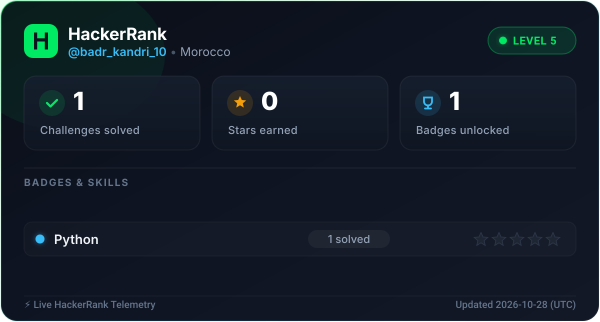

<h1 align="center">Hi, I'm Badr Kandri 👋</h1>

  Engineering student focused on ML fundamentals, deep learning and NLP. 
  I build algorithms from scratch and practice for technical interviews.

  
  

---

## Skills

  
  
  

**Currently learning and practicing**

- ML algorithms from scratch in NumPy (logistic regression, backpropagation, k-means)
- Deep learning, Transformers and NLP
- Data structures and algorithms

---

## Projects

| Repository | Language |
|---|---|
| [Machine-Learning](https://github.com/BadrKandri/Machine-Learning) | Jupyter Notebook |
| [PortNet-Predictive-Modeling](https://github.com/BadrKandri/PortNet-Predictive-Modeling) | Jupyter Notebook |
| [Sofac-commercial-agent](https://github.com/BadrKandri/Sofac-commercial-agent) | Jupyter Notebook |
| [PeaQock_Manus](https://github.com/BadrKandri/PeaQock_Manus) | Python |

---

## HackerRank progress (updates automatically)

  

---

## NeetCode 150 progress (updated by hand)

<!--
HOW TO UPDATE (this comment is invisible on your profile):
1. In a row, change the "Solved" number, e.g. 3 / 9.
2. Redraw the bar: 10 blocks, each block is 10%. Use █ for filled and ░ for empty.
   Example for 3 / 9 (33%): ███░░░░░░░ 33%
3. Update the total line and the date below the table.
-->

| Topic | Solved | Progress |
|---|---|---|
| Arrays & Hashing | 0 / 9 | ░░░░░░░░░░ 0% |
| Two Pointers | 0 / 5 | ░░░░░░░░░░ 0% |
| Sliding Window | 0 / 6 | ░░░░░░░░░░ 0% |
| Stack | 0 / 7 | ░░░░░░░░░░ 0% |
| Binary Search | 0 / 7 | ░░░░░░░░░░ 0% |
| Linked List | 0 / 11 | ░░░░░░░░░░ 0% |
| Trees | 0 / 15 | ░░░░░░░░░░ 0% |
| Heap / Priority Queue | 0 / 7 | ░░░░░░░░░░ 0% |
| Backtracking | 0 / 9 | ░░░░░░░░░░ 0% |
| Tries | 0 / 3 | ░░░░░░░░░░ 0% |
| Graphs | 0 / 13 | ░░░░░░░░░░ 0% |
| Advanced Graphs | 0 / 6 | ░░░░░░░░░░ 0% |
| 1-D Dynamic Programming | 0 / 12 | ░░░░░░░░░░ 0% |
| 2-D Dynamic Programming | 0 / 11 | ░░░░░░░░░░ 0% |
| Greedy | 0 / 8 | ░░░░░░░░░░ 0% |
| Intervals | 0 / 6 | ░░░░░░░░░░ 0% |
| Math & Geometry | 0 / 8 | ░░░░░░░░░░ 0% |
| Bit Manipulation | 0 / 7 | ░░░░░░░░░░ 0% |

**Total: 0 / 150** · Last updated: 2026-10-27
