

  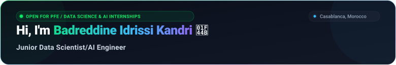

I am a 5th-year State Engineering student at **ENSA Berrechid** specializing in **Information Systems & Big Data**, driven by a passion for bridging theoretical mathematics with scalable production AI. My technical focus centers on architecting **Autonomous Agentic Systems** (LangGraph, Agno, Hybrid RAG with Qdrant), **LLM Fine-Tuning** (PEFT/LoRA), and **Industrial Machine Learning**, from implementing algorithms from first principles in pure NumPy to training models on **5M+ real transactions** ($R^2 = 0.93$) for PortNet. With hands-on experience engineering microservices, streaming pipelines, and AI agents at SOFAC and Peaqock Financials, I am currently seeking an **End-of-Studies Internship (PFE)** in Data Science & AI to deliver impactful, data-driven solutions.

  
  &nbsp;
  
  &nbsp;
  

  

  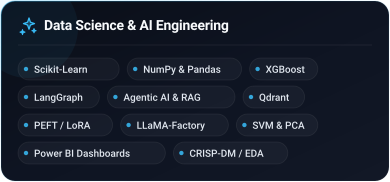
  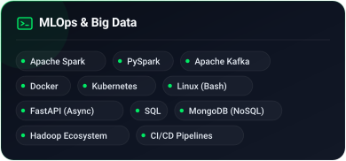

  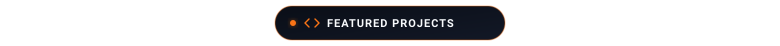

  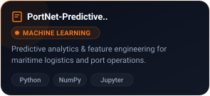
  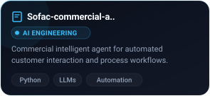
  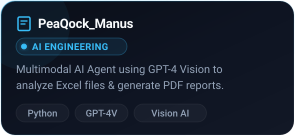

  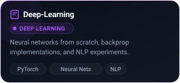
  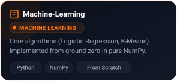
  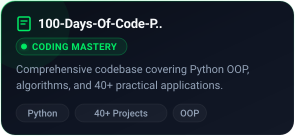

  

  

  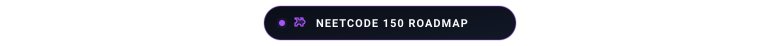

  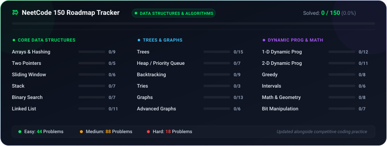

---

  Designed &amp; maintained with ❤️ by Badr Kandri

