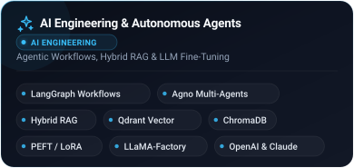
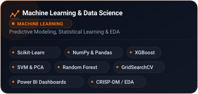
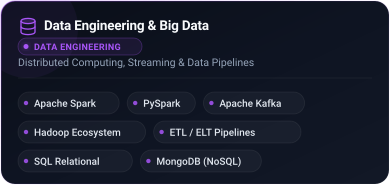
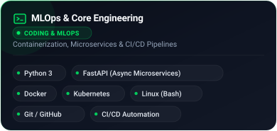

  <h1>Hi, I'm Badr Kandri 👋</h1>
  
  

    <strong>Engineering Student</strong> · Focused on <strong>Machine Learning Fundamentals</strong>, <strong>Deep Learning</strong> & <strong>NLP</strong> 
    <em>Building algorithms from scratch, engineering autonomous AI agents, and mastering problem solving.</em>
  

  

    
     
    
     
    
  

---

### ⚡ About Me

- 🎓 **Focus Areas**: Machine Learning from scratch, Deep Learning architectures (Transformers & CNNs), and NLP.
- 💻 **Hands-on Implementation**: Recreating core algorithms (logistic regression, backprop, k-means) using pure NumPy.
- 🤖 **AI Agents**: Designing multimodal AI agents utilizing GPT-4 Vision, document reasoning, and automation workflows.
- 🎯 **Competitive Coding**: Actively solving technical challenges on HackerRank and NeetCode 150.

---

### 🛠️ Tech Stack & Core Competencies

  
  

  
  

---

### 📂 Featured Projects

  
  
  

  
  
  

---

### 🏆 HackerRank Progress

  

---

### 🧩 NeetCode 150 Progress

<!--
HOW TO UPDATE:
1. In a row, update the Solved count, e.g. 3 / 9.
2. Update the progress bar: 10 blocks (█ = 10%, ░ = 0%).
3. Update the Total line below.
-->

| Category | Solved | Progress |
|:---|:---:|:---|
| **Arrays & Hashing** | `0 / 9` | `░░░░░░░░░░` 0% |
| **Two Pointers** | `0 / 5` | `░░░░░░░░░░` 0% |
| **Sliding Window** | `0 / 6` | `░░░░░░░░░░` 0% |
| **Stack** | `0 / 7` | `░░░░░░░░░░` 0% |
| **Binary Search** | `0 / 7` | `░░░░░░░░░░` 0% |
| **Linked List** | `0 / 11` | `░░░░░░░░░░` 0% |
| **Trees** | `0 / 15` | `░░░░░░░░░░` 0% |
| **Heap / Priority Queue** | `0 / 7` | `░░░░░░░░░░` 0% |
| **Backtracking** | `0 / 9` | `░░░░░░░░░░` 0% |
| **Tries** | `0 / 3` | `░░░░░░░░░░` 0% |
| **Graphs** | `0 / 13` | `░░░░░░░░░░` 0% |
| **Advanced Graphs** | `0 / 6` | `░░░░░░░░░░` 0% |
| **1-D Dynamic Programming** | `0 / 12` | `░░░░░░░░░░` 0% |
| **2-D Dynamic Programming** | `0 / 11` | `░░░░░░░░░░` 0% |
| **Greedy** | `0 / 8` | `░░░░░░░░░░` 0% |
| **Intervals** | `0 / 6` | `░░░░░░░░░░` 0% |
| **Math & Geometry** | `0 / 8` | `░░░░░░░░░░` 0% |
| **Bit Manipulation** | `0 / 7` | `░░░░░░░░░░` 0% |

  <strong>Total Solved: <code>0 / 150</code></strong> · <em>Updated daily alongside competitive coding practice</em>

---

  Designed &amp; maintained with ❤️ by <a href="https://github.com/BadrKandri">Badr Kandri</a>

